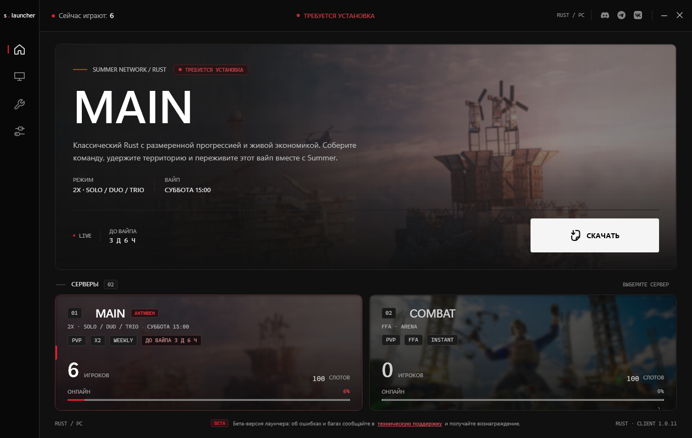
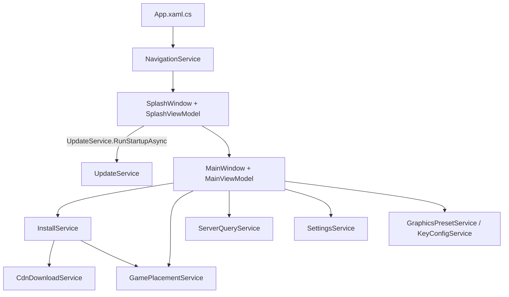

# Summer Launcher

Восстановленный исходный код лаунчера **Summer** — WPF-приложения для Windows, которое устанавливает, проверяет и запускает клиент Rust приватного проекта Summer, показывает онлайн серверов и применяет игровые настройки.



> Репозиторий содержит результат реверс-инжиниринга управляемой .NET-сборки. Это не официальный код проекта Summer и не код Facepunch. Перед публикацией/распространением убедитесь, что у вас есть права на клиент, брендинг и серверные ресурсы.

---

## Содержание

- [Что умеет лаунчер](#что-умеет-лаунчер)
- [Сборка и запуск](#сборка-и-запуск)
- [Структура репозитория](#структура-репозитория)
- [Реверс-инжиниринг и восстановление](#реверс-инжиниринг-и-восстановление)
- [Архитектура](#архитектура)
- [API и сетевые контракты](#api-и-сетевые-контракты)
  - [Манифест игрового клиента (Bunny CDN)](#1-манифест-игрового-клиента-bunny-cdn)
  - [Обновление лаунчера](#2-обновление-лаунчера)
  - [Запрос состояния серверов (A2S / GS4U)](#3-запрос-состояния-серверов-a2s--gs4u)
  - [Локальные файлы состояния](#4-локальные-файлы-состояния)
  - [Контракт запуска игры](#5-контракт-запуска-игры)
- [Безопасность и приватность](#безопасность-и-приватность)
- [Ограничения и планы](#ограничения-и-планы)
- [Информация об агенте](#информация-об-агенте)
- [Лицензия и правовой статус](#лицензия-и-правовой-статус)

---

## Что умеет лаунчер

- **Установка клиента по CDN-манифесту.** Скачивает файлы с Bunny CDN, проверяет SHA-256, докачивает через HTTP Range, распараллеливает загрузку и ведёт чекпоинт проверки.
- **Инкрементальная и полная проверка файлов.** Быстрый режим доверяет кэшу хэшей и времени изменения; полный — пересчитывает SHA-256 всех файлов.
- **Самообновление лаунчера.** Читает манифест обновления, сравнивает версии, скачивает новый `.exe`, проверяет контрольную сумму и перезапускается.
- **Живой онлайн серверов.** A2S_INFO-запрос по UDP с резервным разбором HTML-страницы GS4U; опрос каждые 30 секунд.
- **Графические пресеты.** `combat`, `optimal`, `ultra` — аккуратно вливаются в `cfg/client.cfg`, не удаляя пользовательские строки.
- **Настройка биндов и макросов.** Генерирует `cfg/keys.cfg`, объединяя настройки лаунчера с существующими биндами игрока.
- **Запуск строго из папки игры.** Разрешает старт только из каталога `SUMMER`, `SummerRust` или `SUMMER RUST` и только файла `RustClient.exe`.
- **Локализация RU/EN, звуки интерфейса, кастомный chrome окна.**

---

## Сборка и запуск

### Требования

- Windows 10/11 x64
- .NET SDK 8.0 или новее (проект собирается и на .NET 10 SDK)
- Visual Studio 2022+ или JetBrains Rider — опционально

### Сборка

```powershell
dotnet build .\src\Summer.csproj -c Release
```

Ожидаемый результат: `0 Error(s)`, `0 Warning(s)`, файл `src\bin\Release\net8.0-windows\Summer.exe`.

### Запуск

1. Скопируйте содержимое `src\bin\Release\net8.0-windows\` в папку с именем **`SUMMER`**, **`SummerRust`** или **`SUMMER RUST`**.
2. Если игра уже установлена, рядом должен лежать `RustClient.exe`.
3. Запустите `Summer.exe`.

Лаунчер намеренно отказывается работать из произвольного каталога: это защита от запуска «откуда попало» и одновременно требование оригинального клиента. При нарушении показывается предупреждение о перемещении в папку `SUMMER`.

> Для чистой установки без игры: создайте пустую папку `SUMMER`, положите туда лаунчер и нажмите «СКАЧАТЬ». Клиент будет загружен в эту же папку.

### CI

Сборка автоматизирована в GitHub Actions: `.github/workflows/build.yml`.

- запускается на `push` в `main`, на pull request и вручную (`workflow_dispatch`);
- собирает `src/Summer.csproj` в конфигурации `Release` на `windows-latest` с .NET 8;
- выкладывает готовый артефакт **Summer-win-x64** (`src/bin/Release/net8.0-windows/`) на 14 дней.

Скачать артефакт можно на вкладке **Actions → Build → нужный запуск → Artifacts**.

**Готовый билд:** [Summer-win-x64 — артефакт Actions](https://github.com/createprojectile/summer-launcher/actions/runs/41782642915/artifacts/13300150693)

> Репозиторий пока приватный: для скачивания нужен вход в GitHub с доступом к нему. Ссылка ведёт на конкретный запуск, а артефакты хранятся 14 дней — после публикации репозитория или истечения срока её нужно обновить.

### Релизы

Публикация в **GitHub Releases** автоматизирована: `.github/workflows/release.yml`.

Workflow запускается при push тега вида `v*`, собирает проект через `dotnet publish`, упаковывает файлы в `Summer-<тег>-win-x64.zip` и создаёт (или обновляет) Release с автоматическими release notes.

```powershell
git tag v1.0.11
git push origin v1.0.11
```

Готовые релизы: [github.com/createprojectile/summer-launcher/releases](https://github.com/createprojectile/summer-launcher/releases)

> Сборка в релизе framework-dependent: для запуска нужен [.NET 8 Desktop Runtime](https://dotnet.microsoft.com/download/dotnet/8.0) (x64). В приватном репозитории релизы и ассеты видны только пользователям с доступом.

---

## Структура репозитория

```text
SummerLauncher/
├── src/
│   ├── Summer/                  # App.xaml, App.xaml.cs — точка входа
│   ├── Summer.Controls/         # Кастомные контролы: логотип, спиннер, Sparkline, KeyCaptureButton
│   ├── Summer.Helpers/          # Команды, конвертеры, DWM-эффекты, звук, WindowChrome
│   ├── Summer.Models/           # Модели: настройки, манифесты, InstallState, ServerInfo
│   ├── Summer.Services/         # Сеть, CDN, обновления, проверка файлов, запуск, локализация
│   ├── Summer.ViewModels/       # MainViewModel, SettingsViewModel, SplashViewModel
│   ├── Summer.Views/            # XAML-экраны: MainWindow, MainPage, GraphicsPage, ToolsPage, SettingsPage
│   ├── themes/                  # tokens.xaml, controls.xaml, icons.xaml — дизайн-система
│   ├── assets/                  # Иконки, обложки серверов, пресеты, звук
│   ├── Properties/AssemblyInfo.cs
│   ├── app.ico
│   ├── app.manifest
│   └── Summer.csproj
├── docs/screenshot-main.png
├── .gitattributes
├── .gitignore
└── README.md
```

---

## Реверс-инжиниринг и восстановление

### Исходный материал

Код получен из управляемой .NET/WPF-сборки. Декомпилятор восстановил C#-код и XAML, но не проект сборки. Характерные следы декомпиляции, которые пришлось учитывать:

- явные backing-поля и вызовы `SetProperty(ref field, value, "Property")` вместо `CallerMemberName`;
- развёрнутые `switch`/`foreach`, локальные функции, `[..]`-коллекции;
- потерянные имена сборок, версии, `AssemblyInfo`;
- XAML с логическими именами в нижнем регистре (`views/mainpage.xaml`), на которые ссылаются pack URI;
- пустые каталоги `controls/` и `views/`, созданные декомпилятором как артефакты.

### Что было восстановлено

| Проблема | Решение |
| --- | --- |
| Отсутствовал `.csproj` | Собран SDK-style проект `net8.0-windows`, `UseWPF=true`, `WinExe`, `x64` |
| Декомпилированный код не компилировался из-за nullable-аннотаций | `Nullable=annotations` + сохранение исходных аннотаций; предупреждения не подавляются глобально |
| XAML-ресурсы имели нестандартные логические имена | `EnableDefaultPageItems=false`, явные `<Page … LogicalName="views/mainpage.xaml" />` |
| `App.xaml` не подхватывался как ApplicationDefinition | `EnableDefaultApplicationDefinition=false` + явный `<ApplicationDefinition>` |
| Дублировалась генерация атрибутов сборки | `GenerateAssemblyInfo=false`, атрибуты оставлены в `Properties/AssemblyInfo.cs` |
| Потерянные иконка и манифест | `ApplicationIcon=app.ico`, `ApplicationManifest=app.manifest` |
| Мусорные каталоги декомпилятора | Удалены `controls/`, `views/`, `web/`, `.idea/`, `bin/`, `obj/` |

### Проверка

```text
Build succeeded.
    0 Warning(s)
    0 Error(s)
```

Сборка проверена в конфигурациях Debug и Release. Дополнительно приложение запускалось: splash-экран проходит проверку обновлений, главное окно открывается, A2S-запрос к серверу MAIN возвращает онлайн.

### Важные особенности исходников

- `src\Summer.csproj` **не использует** glob-включение XAML: все страницы и ресурсы перечислены явно. При добавлении нового экрана его нужно добавить и в `.csproj`, иначе `pack://`-ссылка упадёт во время выполнения.
- Ресурсы ищутся по путям `pack://application:,,,/Assets/...`; на диске каталог называется `assets` — регистр не важен для WPF, но логические имена в `.csproj` заданы в нижнем регистре.
- `Properties/AssemblyInfo.cs` содержит `InternalsVisibleTo("Summer.Tests")`. Тестового проекта в репозитории нет — это наследие оригинала.
- Версия лаунчера в интерфейсе берётся из `UpdateService.ClientVersion`: сначала файл `.launcher_version`, затем `ProductVersion` exe, затем `AssemblyInformationalVersion` (`1.0.11`).

---

## Архитектура



| Слой | Основные типы | Ответственность |
| --- | --- | --- |
| Точка входа | `Summer.App` | Загрузка настроек, звука, сервисов, глобальные обработчики ошибок |
| Навигация | `NavigationService` | Splash → главное окно, закрытие предыдущего окна, сохранение настроек |
| ViewModels | `SplashViewModel`, `MainViewModel`, `SettingsViewModel` | Состояние UI, команды, таймеры, оркестрация установки/запуска |
| Установка | `InstallService`, `CdnDownloadService` | Манифест, проверка, докачка, SHA-256, чекпоинты |
| Размещение | `GamePlacementService` | Проверка каталога, поиск `RustClient.exe`, запуск процесса |
| Обновления | `UpdateService` | Манифест лаунчера, сравнение версий, self-replace |
| Серверы | `ServerQueryService` | A2S UDP, fallback GS4U, ping |
| Конфиги | `SettingsService`, `GraphicsPresetService`, `KeyConfigService` | JSON-настройки, `client.cfg`, `keys.cfg` |
| UI-инфраструктура | `Summer.Controls`, `Summer.Helpers`, `themes` | Контролы, конвертеры, DWM, звук, токены стилей |

### Поток запуска

1. `App.OnStartup` подписывается на необработанные исключения (`ErrorLog`), удаляет старые `.old`, читает настройки, инициализирует звук и сервисы.
2. `NavigationService` показывает splash и запускает `SplashViewModel.RunAsync()`.
3. `UpdateService.RunStartupAsync` проверяет манифест лаунчера. При наличии обязательного обновления скачивает и перезапускает приложение.
4. После splash создаётся `MainViewModel`: загружается `InstallState`, строятся карточки серверов и инструментов, запускаются таймеры (вайп — 1 c, онлайн — 30 c).
5. `InitializeAsync` получает версию игрового манифеста и обновляет состояние кнопки: «СКАЧАТЬ» / «ОБНОВИТЬ» / «ИГРАТЬ».
6. «Играть» вызывает `EnsureInstalledAsync`, затем `GamePlacementService.LaunchGame`.

---

## API и сетевые контракты

> **Важно:** в лаунчере **нет локального HTTP API**. Веб-версия и её API-слой были удалены из проекта. Всё ниже — реальные внешние интеграции WPF-приложения и форматы локальных файлов.

### 1. Манифест игрового клиента (Bunny CDN)

**Endpoint**

```http
GET https://client-summer-rust.b-cdn.net/SUMMER/manifest.json?request=<guid>
User-Agent: SummerLauncher/1.4.7
Accept: */*
```

Параметр `request` — случайный GUID, чтобы обойти кэш CDN. Базовый URL задан в `CdnDownloadService.DefaultCdnBaseUrl`; `InstallService` допускает подмену через конструктор. Если переданный URL уже заканчивается на `manifest.json`, он используется как есть.

**Схема ответа**

```json
{
  "version": "1.0.11",
  "buildDate": "2026-10-25T12:00:00Z",
  "url": "https://client-summer-rust.b-cdn.net/SUMMER",
  "files": [
    {
      "path": "RustClient.exe",
      "sha256": "9f2c...e1",
      "size": 812345,
      "url": null
    },
    {
      "path": "RustClient_Data/sharedassets0.assets",
      "sha256": "aa10...7b",
      "size": 1073741824
    }
  ]
}
```

| Поле | Тип | Обязательное | Описание |
| --- | --- | --- | --- |
| `version` | string | да | Версия клиента; пустая строка — ошибка `Манифест CDN пуст` |
| `buildDate` | string? | нет | Дата сборки, информационное поле |
| `url` | string? | нет | База для файлов; если пусто — вычисляется из URL манифеста |
| `files[].path` | string | да | Относительный путь, `/` или `\`; обязан оставаться внутри папки установки |
| `files[].sha256` | string | да | SHA-256 в hex, сравнение без учёта регистра |
| `files[].size` | long | да | Ожидаемый размер в байтах |
| `files[].url` | string? | нет | Абсолютный URL конкретного файла |

**Формирование URL файла**

```text
{manifest.url}/{percent-encoded path segments}?sha256={sha256}
```

Каждый сегмент пути кодируется через `Uri.EscapeDataString`, поэтому пробелы и кириллица в именах безопасны.

**Алгоритм установки/проверки**

1. Проверяется имя каталога лаунчера (`SUMMER`, `SummerRust`, `SUMMER RUST`). Иначе — ошибка без сетевых запросов.
2. Манифест скачивается с 3 попытками и задержкой 1 с / 2 с.
3. Из манифеста исключаются пользовательские файлы, которые лаунчер не должен перезаписывать:
   `cfg/client.cfg`, `cfg/keys.cfg`, `cfg/key.cfg`, `key.cfg`, `keys.cfg`, `Summer.exe`, `SummerLauncher.exe`, `.doorstop_version`, `dotnet/.version`, а также имя текущего исполняемого файла.
4. Файлы проверяются последовательно:
   - быстрое сравнение размера;
   - попадание в кэш `state.json` по хэшу **и** `LastWriteTimeUtc`;
   - иначе — потоковый SHA-256 с прогрессом (буфер 1 МиБ).
5. «Presence-only» файлы (`temp/`, `StreamingAssets/WorkshopSource/`, `MenuVideo/`, `keymidi/`, `Instruments/`) в быстром режиме проверяются только на существование.
6. Недостающие/битые файлы ставятся в очередь. Загрузка идёт в **2–4 параллельных задачи** (`ProcessorCount`, ограничено 2..4).
7. Каждый файл пишется в `<path>.part`; при повторе отправляется `Range: bytes=<existing>-`. Если сервер отвечает `200 OK` вместо `206 Partial Content`, загрузка начинается заново. Некорректный `Content-Range` — ошибка.
8. После загрузки проверяются размер и SHA-256, затем `.part` атомарно переименовывается в целевой файл.
9. Прогресс проверки сохраняется в чекпоинт не чаще раза в 5 секунд или каждые 10 файлов.
10. Перед загрузкой проверяется свободное место с запасом 10 %.
11. В конце ищется `RustClient.exe`; без него установка считается неуспешной. `state.json` перезаписывается.

**Ретраи**

Повторяются `HttpRequestException`, `IOException`, `UnauthorizedAccessException`, `InvalidDataException` — до 3 попыток с экспоненциальной задержкой 1 с / 2 с. `OperationCanceledException` пробрасывается сразу (пауза/отмена).

### 2. Обновление лаунчера

**Endpoint**

```http
GET https://summer-launcher.b-cdn.net/launcher/launcher-version.json?t=<unix-seconds>
User-Agent: SummerLauncher/<client-version>
Accept: application/json, application/octet-stream, */*
```

URL можно переопределить: `UpdateService(updateUrl: ...)` или полем `launcherUpdateUrl` в настройках. `t` добавляется для обхода кэша.

**Схема ответа**

```json
{
  "version": "1.0.12",
  "url": "https://summer-launcher.b-cdn.net/launcher/Summer-1.0.12.exe",
  "sha256": "1c9f...ab",
  "size": 29200000,
  "mandatory": true,
  "changelog": "Исправлена докачка и обновлён экран серверов."
}
```

| Поле | Тип | По умолчанию | Описание |
| --- | --- | --- | --- |
| `version` | string | — | Версия; пустая — манифест игнорируется |
| `url` | string | — | Прямая ссылка на новый `.exe` |
| `sha256` | string | `""` | Если задан — проверяется после загрузки |
| `size` | long | `0` | Используется для прогресса, если нет `Content-Length` |
| `mandatory` | bool | `true` | Обязательное обновление: ошибка не глотается |
| `changelog` | string? | `null` | Не отображается в текущем UI |

**Сравнение версий**

```text
remote == local                    → обновление не нужно
Version.TryParse(remote/local)     → remote > local
иначе                              → строки не равны
```

`ClientVersion` определяется в таком порядке:

1. `.launcher_version` рядом с exe (если содержимое парсится как `Version`);
2. `ProductVersion` файла `Summer*.exe` (обрезается по `+`, должно быть `> 1.0.0`);
3. `AssemblyInformationalVersion` (обрезается по `+`);
4. `AssemblyVersion`, если major > 0;
5. fallback `1.0.0`.

**Применение обновления**

1. Скачивание в `<currentExe>.new` потоком 80 КиБ.
2. Проверка `sha256`, если поле задано; при несовпадении `.new` удаляется и бросается `InvalidDataException`.
3. Текущий exe переименовывается в `.old` (если старый `.old` залочен — в `Summer.<guid>.old`).
4. `.new` переименовывается в текущий exe, пишется `.launcher_version`.
5. Запускается новый процесс, текущий завершается через `Environment.Exit(0)`.
6. При следующем старте `CleanupOldBinary()` удаляет `*.old`.

Если обновление необязательное и загрузка упала, splash продолжает работу. При обязательном — ошибка прерывает запуск.

### 3. Запрос состояния серверов (A2S / GS4U)

**A2S_INFO (UDP)**

```text
Запрос:  FF FF FF FF 54 "Source Engine Query\0"
Порт:    queryPort (MAIN 5557, COMBAT 4446)
Таймаут: 2.5 с
```

Если сервер отвечает challenge-пакетом (`buffer[4] == 0x41`), лаунчер повторяет запрос с 4-байтовым challenge из ответа. Ответ `0x49` (`I`) разбирается как:

| Поле | Чтение |
| --- | --- |
| protocol | 1 байт (пропускается) |
| name | null-terminated UTF-8 |
| map | null-terminated UTF-8; пусто → `summer-rust.top` |
| folder | null-terminated (пропускается) |
| game | null-terminated (пропускается) |
| app id | int16 (пропускается) |
| players | byte |
| max players | byte |
| ping | измеряется локально, минимум 1 мс |

**GS4U fallback**

Если A2S недоступен и у сервера задан `Gs4uUrl`, выполняется GET HTML-страницы (таймаут 3 с). Разбор:

- онлайн/слоты: `itemprop="playersOnline"> N </b> … <b> M </b>`;
- карта: `<meta name="twitter:description" content="…карта <map>,">`;
- имя в fallback жёстко `SUMMER NOLIMIT | X2`, ping `35`.

**Опрос**

- при старте главного окна;
- каждые 30 секунд (`DispatcherTimer`);
- ошибка любого рода → `IsOnline = false`, поля не обновляются;
- если `Host` пуст или `QueryPort <= 0`, возвращаются статические значения модели.

**Серверы в прошивке**

| ID | Имя | Игра | Query | GS4U |
| --- | --- | --- | --- | --- |
| `main` | MAIN | `144.31.12.240:5555` | `5557` | `https://www.gs4u.net/ru/s/432992` |
| `combat` | COMBAT | `144.31.12.240:4444` | `4446` | — |

Список и адреса захардкожены в `MainViewModel.CreateServers()`; API для их изменения нет.

### 4. Локальные файлы состояния

#### Настройки лаунчера

```text
%APPDATA%\SummerLauncher\launcher-settings.json
```

JSON в camelCase, отформатирован, допускает комментарии и trailing commas при чтении.

```json
{
  "installPath": "C:\\SUMMER",
  "fpsBoosterEnabled": false,
  "uiSoundsEnabled": true,
  "uiSoundVolume": 70,
  "minimizeOnGameLaunch": true,
  "launchArguments": "",
  "selectedServerId": "main",
  "launcherUpdateUrl": null,
  "language": "ru",
  "graphicsPreset": "optimal",
  "keyBinds": [{ "actionName": "Вперёд", "description": "...", "command": "+forward", "key": "w" }],
  "macroBinds": [{ "actionName": "Автобег", "description": "...", "command": "bind [кнопка] +forward", "key": "x" }]
}
```

Поведение `SettingsService`:

- запись атомарная: `<file>.<guid>.tmp` → `File.Move(..., overwrite: true)`;
- при сохранении удаляется устаревшее поле `cdnBaseUrl`;
- при ошибке чтения файл переименовывается в `launcher-settings.json.corrupt-yyyyMMdd-HHmmss`, возвращаются значения по умолчанию;
- нормализация: `installPath` trim/кавычки, громкость клампится в 0..100, `selectedServerId` в нижний регистр, основные бинды дополняются 10 дефолтными действиями, макросы — 19 стандартными макросами.

#### Кэш установки

```text
<папка игры>\.summer-launcher\state.json
```

```json
{
  "version": "1.0.11",
  "files": {
    "RustClient.exe": "9f2c...e1",
    "RustClient_Data/sharedassets0.assets": "aa10...7b"
  },
  "verifiedWriteTimesUtc": {
    "RustClient.exe": 638650000000000000
  },
  "clientExePath": "RustClient.exe"
}
```

`files` — последний подтверждённый SHA-256, `verifiedWriteTimesUtc` — тики `LastWriteTimeUtc` на момент проверки. Запись также атомарная (`.tmp` + `Move`). Кэш позволяет пропускать хэширование неизменившихся файлов.

#### `cfg/keys.cfg`

Формат Rust: `bind <key> <command>`. Лаунчер:

- читает существующий файл и сохраняет не-bind строки;
- при отсутствии файла берёт 19 стандартных биндов;
- применяет пользовательские бинды и макросы, удаляя старую привязку того же действия;
- нормализует имена клавиш (ЛКМ → `mouse0`, Ctrl → `leftcontrol`, Enter → `return`, Numpad → цифры и т. д.);
- подставляет в макросы `[кнопка]`/`[button]`/`[key]` → клавиша, `[количество]` → `5`, `[n]` → `0.8`, `[m]` → `1.0`;
- пишет через `<file>.summer.tmp` + `File.Move(overwrite: true)`, UTF-8 без BOM.

#### `cfg/client.cfg`

Графические пресеты хранятся в `assets/presets/*.cfg` и дублируются константами в `GraphicsPresetService`. При применении:

- комментарии и пустые строки пресета отбрасываются;
- каждая строка `key value` вливается в существующий `client.cfg` по ключу;
- порядок и незнакомые пользовательские строки сохраняются;
- с файла снимается атрибут `ReadOnly`;
- запись атомарная, UTF-8 без BOM.

Пресеты: `combat` (минимум эффектов, максимум FPS), `optimal` (баланс), `ultra` (максимальная детализация). Неизвестный ID нормализуется в `optimal`.

### 5. Контракт запуска игры

`GamePlacementService` — последний барьер перед `Process.Start`. Проверки выполняются в таком порядке:

1. Каталог лаунчера называется `SUMMER`, `SummerRust` или `SUMMER RUST`.
2. Рядом существует `RustClient.exe` и это не reparse point (симлинк/джанкшен).
3. `installPath` из настроек совпадает с каталогом лаунчера (после `GetFullPath`).
4. Путь к exe лежит внутри каталога игры.
5. Имя файла ровно `RustClient.exe` (без учёта регистра).
6. Найденный `FindRustClient` указывает на тот же файл.
7. Запуск: `UseShellExecute=true`, `WorkingDirectory` = папка игры, аргументы из `launchArguments`.

Дополнительно: при `MinimizeOnGameLaunch` окно сворачивается, а после выхода процесса восстанавливается. Лаунчер не внедряется в процесс, не читает память игры и не обходит античит.

---

## Безопасность и приватность

- **Нет телеметрии и аккаунтов.** Лаунчер не отправляет идентификаторы, не логинится на серверы и не хранит токены.
- **Сеть только по HTTPS** к двум CDN и GS4U (fallback). Игровые серверы опрашиваются по UDP.
- **Проверка целостности.** Все скачанные файлы сверяются по размеру и SHA-256; обновление лаунчера — по SHA-256, если он указан.
- **Доверие манифесту.** Хэши берутся из того же манифеста, что и файлы. Подписи манифеста нет — при компрометации CDN злоумышленник сможет подменить и файлы, и хэши. Для публичного распространения рекомендуется подписывать манифест отдельным ключом.
- **Защита от path traversal.** `InstallService.ToAbsolutePath` проверяет, что итоговый путь остаётся внутри каталога установки; небезопасные записи манифеста отклоняются.
- **Обновление без подписи exe.** Проверяется только SHA-256 из манифеста; Authenticode-подпись не валидируется.
- **Ошибки пишутся локально.** `ErrorLog` сохраняет технические подробности; перед публикацией логов проверьте пути и имена пользователя.
- **Права администратора не запрашиваются.** `app.manifest` содержит только DPI-awareness; запись в `Program Files` без прав ожидаемо упадёт.

---

## Ограничения и планы

- Нет подписи манифестов и проверки Authenticode — см. раздел безопасности.
- Нет дифференциальных обновлений: при изменении версии скачиваются только несовпавшие файлы, но не патчи.
- HTML-парсинг GS4U хрупок и сломается при изменении вёрстки; A2S — основной источник.
- Список серверов, тексты и ссылки на инструменты захардкожены.
- `LocalizationService` хранит RU/EN-строки в коде, а не в ресурсных `.resx`.
- `FpsBoosterEnabled` присутствует в модели настроек, но отдельной реализации бустера в восстановленном коде нет.
- `InternalsVisibleTo("Summer.Tests")` без тестового проекта.
- Веб-версия и локальный HTTP API **не входят** в проект и были удалены как отдельная, отменённая ветка разработки.

---

## Информация об агенте

Этот репозиторий подготовлен AI-агентом в среде OpenCode (модель DeepSeek V4.1 Flash Free) 4 ноября 2026 года.

**Задача агента:** восстановить компилируемый WPF-проект из декомпилированных исходников, убрать артефакты декомпилятора, задокументировать реверс и сетевые контракты, подготовить репозиторий к публикации.

**Методика:**

1. Инвентаризация файлов и определение пустых каталогов-артефактов (`controls/`, `views/`, `web/`, `.idea/`).
2. Статический анализ C# и XAML: точки входа, сервисы, ViewModels, сетевые вызовы, форматы файлов.
3. Восстановление `Summer.csproj` с явными `Page`/`Resource`/`ApplicationDefinition` и логическими именами.
4. Итеративная сборка `dotnet build` до `0 Warning(s), 0 Error(s)`.
5. Запуск собранного приложения в изолированной папке `SUMMER` и проверка реального A2S-запроса.
6. Снятие скриншота главного окна через Win32 `PrintWindow` с флагом `PW_RENDERFULLCONTENT`.
7. Написание документации на основе кода, а не предположений; все URL, поля и лимиты сверены с исходниками.

**Что агент не делал:**

- не изменял бизнес-логику лаунчера;
- не добавлял сетевые вызовы, аналитику или новые зависимости;
- не публиковал бинарники клиента Rust и не обходил лицензионные ограничения;
- не проверял работу с реальным игровым клиентом после установки (в среде восстановления отсутствовал `RustClient.exe`).

**Воспроизводимость для следующего агента:**

```powershell
dotnet build .\src\Summer.csproj -c Release
# ожидается 0/0
```

При доработке UI помните: новый XAML нужно явно добавить в `src\Summer.csproj`, иначе он не попадёт в сборку. При изменении сетевых контрактов обновите разделы [API](#api-и-сетевые-контракты) и модели в `src\Summer.Models`.

---

## Лицензия и правовой статус

Файл лицензии не добавлен намеренно: код является результатом реверс-инжиниринга стороннего клиента и содержит брендинг Summer. Решать вопрос прав на распространение должен владелец проекта.

Rust и Facepunch являются товарными знаками соответствующих правообладателей. Проект не связан с Facepunch Studios.
